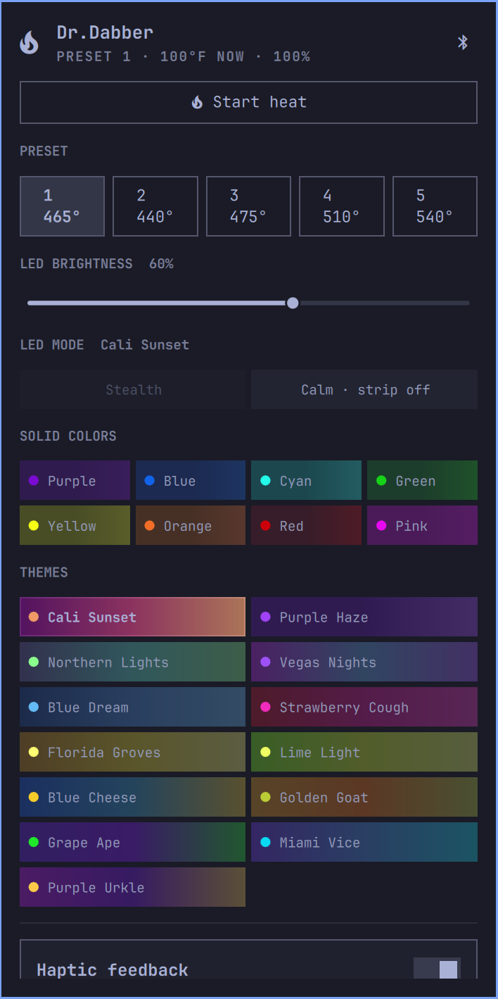

# Dr.Dabber for the Omarchy bar

An [Omarchy](https://omarchy.org/) bar widget for the **Dr.Dabber Switch 2**. Live status on the bar
(battery, and temperature while heating); click for a panel with heat start/stop, the five presets, LED
brightness, **LED modes by name with color tiles**, haptics and cleaning assist.



It does not talk Bluetooth itself. It talks to Home Assistant, which owns the Switch's single Bluetooth
connection through the companion integration
[micahelj/dr-dabber-ha](https://github.com/micahelj/dr-dabber-ha). State is pushed over Home Assistant's
WebSocket the moment the device changes, so the bar and panel update instantly; taps show immediately and are
confirmed (or rolled back after ~2.5 s) by Home Assistant's real state.

## Requirements
- Omarchy with the shell plugin system.
- The [dr-dabber-ha](https://github.com/micahelj/dr-dabber-ha) integration installed in Home Assistant
  (v0.2.0+ for LED mode names and Stealth; v0.1.x works with numbered modes).
- System `python3` with `aiohttp` (`sudo pacman -S python-aiohttp` on Arch).
- A Home Assistant long-lived access token saved to `~/.config/homeassistant/token`
  (Profile -> Security -> Long-lived access tokens). The token is read by a helper process from that file;
  it is never passed on a command line or put in `shell.json`.

## Install
```bash
git clone https://github.com/micahelj/omarchy-dr-dabber ~/.config/omarchy/plugins/shawn.dabber
omarchy bar put shawn.dabber --after omarchy.clock          # or wherever you like
omarchy bar set shawn.dabber haUrl http://YOUR-HA-HOST:8123
omarchy restart shell
```
The plugin id is `shawn.dabber`, so the folder name must match it.
Settings (`haUrl`, `tokenFile`, `showBattery`) are in the widget's settings or `~/.config/omarchy/shell.json`.

## Use
- Click the bar icon to open the panel. Middle-click the icon to **stop heat** immediately.
- Keys in the panel: `1`-`5` preset, `[` `]` previous/next LED mode, `x` stop heat.
- Heat only starts from an explicit click on **Start heat** (or `heat start` over IPC). Stopping always works.
- The Bluetooth button in the panel header releases the Switch so the phone app can connect (the device accepts
  one connection at a time); click it again to take the connection back.

### IPC (for keybindings)
```bash
omarchy-shell shawn.dabber status          # one-line summary
omarchy-shell shawn.dabber toggle          # open/close panel
omarchy-shell shawn.dabber preset 3
omarchy-shell shawn.dabber brightness 40
omarchy-shell shawn.dabber led 10          # mode number, see Modes.js
omarchy-shell shawn.dabber heat start|stop
omarchy-shell shawn.dabber clean start|stop
```

## LED modes
0 Stealth (everything off, including the button light), 1 Calm (strip off, button light stays on), 2-9 solid colors, 10-17 and 24-28 themes
(Cali Sunset, Purple Haze, Northern Lights, Vegas Nights, Blue Dream, Strawberry Cough, Florida Groves,
Lime Light, Blue Cheese, Golden Goat, Grape Ape, Miami Vice, Purple Urkle); 18-23 are unused.
Names come from the vendor app; Stealth and Calm are confirmed on hardware. Tile colors are approximate.

## Notes
- Unofficial; not affiliated with Dr. Dabber. The device heats: use at your own risk. Its own auto-shutoff
  still applies.
- Network access is limited to the Home Assistant URL you configure. Only entities of the `dr_dabber`
  integration can be controlled, through a small allow-list of services.
- QML changes need `omarchy restart shell` to take effect.

MIT licensed.
